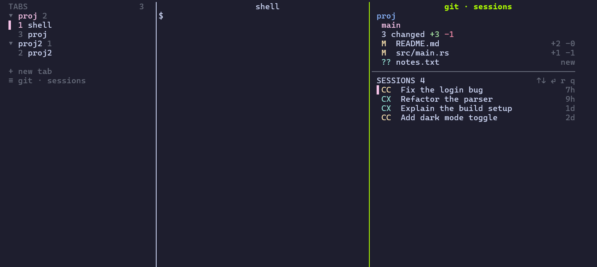

# zj-sidebar

[中文](README.zh-CN.md)

A [zellij](https://zellij.dev) plugin for people who run Claude Code / Codex in many projects at once.

- **Vertical tab list** on the left, **grouped by working directory**. Click a group to fold/unfold it, click a tab to switch.
- **Git + sessions panel** on the right (toggle with a click or a key):
  - top: directory, branch (ahead/behind), changed files with `+added -deleted`; `Enter` on a file opens its **side-by-side diff** in a floating overlay;
  - **commit** (`c`, or `commit ▸` on the changes line): IDEA-style commit dialog with the changed files as checkboxes (all checked), "amend last commit" (pre-fills the last message) and "push after commit", and a multi-line message (`Alt+Enter` = new line); only the checked files are committed, new and deleted ones included;
  - click the branch (or `b`) for an **IntelliJ IDEA-style branch popup**: type to filter local/remote branches (remotes are fetched in the background when it opens), and per branch: checkout (a remote branch becomes a local tracking branch), new branch from it, checkout & rebase, rebase/merge into the current one, push, rename, delete; plus update (pull), push, fetch, stash/unstash, and continue/abort a merge or rebase in progress;
  - bottom: the **Claude Code and Codex sessions of that directory**, newest first. `↑/↓` + `Enter` (or click) resumes one:
    - already open in some pane (marked `●`) → jumps to it;
    - current shell idle → types `claude --resume <id>` / `codex resume <id>` there;
    - otherwise → opens a new tab in the same directory.
- **Git Log window** (`log ▸` on the branch line, `l` in the panel, or `Alt+Shift+g` from the shell): the commit graph of all branches with hash, refs, subject, author and date (connector rows keep each lane's line continuous); the selected commit's changed files and full message beside it; `Enter` on a file shows the commit's diff. `Enter` (or `m`, or right-click where the terminal passes it on) on a commit opens IDEA's actions — copy hash, checkout revision, new branch/tag, cherry-pick, revert, reset (soft/mixed/hard/keep), undo commit, edit message, interactive rebase from here, push up to here — or a file (`m`) for show diff, compare with local, history, get from revision. Everything that changes your files, history or the remote (stash, pull, push, merge, rebase, cherry-pick, revert, reset, undo, delete…) asks first; when a git command fails (a rejected push, an unreachable remote…) its full message is shown until you dismiss it.
- Works on **Linux, macOS and Windows** (zellij ≥ 0.45).

<!-- screenshot -->


## Install

You need [zellij](https://zellij.dev/documentation/installation) 0.45.x and `git`.

**Linux / macOS**

```sh
curl -fsSL https://raw.githubusercontent.com/sunwu51/zj-sidebar/main/install.sh | bash
```

**Windows (PowerShell)**

```powershell
irm https://raw.githubusercontent.com/sunwu51/zj-sidebar/main/install.ps1 | iex
```

Add `-PatchProfile` (download the script first: `./install.ps1 -PatchProfile`) to also add the pwsh hook described under [Windows](#windows). To build from a checkout instead of downloading: `./install.sh --from-source` / `./install.ps1 -FromSource` (needs Rust).

The installer puts three things in place and **never edits your `config.kdl`**:

| File | Where |
|---|---|
| plugin `zj-sidebar.wasm` | `<zellij config dir>/plugins/` |
| layout `sidebar.kdl` | `<zellij config dir>/layouts/` |
| helper `zjsb-helper` | `~/.local/share/zj-sidebar/` (Windows: `%LOCALAPPDATA%\zj-sidebar\`) |

Then:

```sh
zellij --layout sidebar            # try it (use `zellij -n sidebar` to force a new session)
```

and to make it the default, add to `config.kdl`:

```kdl
default_layout "sidebar"
```

**First start:** the sidebar asks zellij for permissions. Click the sidebar and press `y`. (After updating from 0.1.x it asks once more, for the clipboard permission used by "copy hash".) (A brand-new zellij also shows its own first-run wizard; press `Esc`.)

### Example config

[`examples/config.kdl`](examples/config.kdl) has everything below in one file (default layout, the panel key `Alt+d`, a floating-shell key `Alt+j`). It only adds to zellij's defaults, so you can use it as your whole `config.kdl` or merge it into yours.

### Optional: a key for the panel

Click `≡ git · sessions` at the bottom of the left sidebar, or bind a key (the installer prints this line with your real path) inside `keybinds { shared_except "locked" { … } }`:

```kdl
bind "Alt d" { MessagePlugin "file:~/.config/zellij/plugins/zj-sidebar.wasm" { name "toggle_panel"; }; }
bind "Alt g" { MessagePlugin "file:~/.config/zellij/plugins/zj-sidebar.wasm" { name "focus_panel"; }; }
bind "Alt Shift g" { MessagePlugin "file:~/.config/zellij/plugins/zj-sidebar.wasm" { name "git_log"; }; }
```

`toggle_panel` opens/closes the panel; `focus_panel` moves the keyboard from the shell into the panel (opening it if needed) and, pressed again, back to the shell, with the panel left open; `git_log` opens the Git Log window for the focused shell's repository.

On macOS, `Alt` needs "Option as Alt/Meta" in your terminal (kitty: `macos_option_as_alt yes`, iTerm2: Profiles → Keys → Left Option = Esc+, Terminal.app: Use Option as Meta key, Alacritty: `option_as_alt = "Both"`).

## Using it

| | |
|---|---|
| Left sidebar | click a group header to fold; click a row to switch; `+ new tab` opens one in the current directory; mouse wheel scrolls |
| Panel | two lists, each with its own cursor, scrolling and counter (`3/18` next to the file summary, `5/50` next to SESSIONS): `j`/`k`/`↑`/`↓` move inside the focused list and stop at its ends, `Tab` switches list, `Enter` or click the selected row opens it (file → diff overlay, session → resume), `g`/`G` first/last, `r` refresh, `c` commit, `b` branch popup, `l` Git Log window, `f` fetch, `q`/`Esc` close; from the shell `Alt+g` jumps in here and back (see the keybindings above) |
| Commit dialog | type the message (`Alt+Enter` or a trailing `\` then `Enter` = new line, `Enter` commits), `Tab` switches to the file/option list: `↑`/`↓` move, `Space` (or click) toggles a file / amend / push, `a` all files; `Ctrl+U` clears the message; `Esc` closes and keeps the message as a draft; if git refuses (e.g. a hook fails) the dialog stays open with the error |
| Branch popup | type to filter, `↑`/`↓` move, `Enter`/`→` (or click) opens the branch's actions (each has a letter key, e.g. `c` checkout), `Backspace` edits the filter, `Esc` clears it / closes; in the panel it takes the panel's body |
| Git Log window | `j`/`k` move, `Enter`/`m` = the commit's actions menu (its first item, `f`, shows the changed files), `l`/`Tab`/`→` into the files, `Enter` on a file = diff, `m` = file actions, `h`/`←` back; `c` commit, `b` branches, `/` filter (subject, author, hash, refs), `a` all branches ↔ current branch, `y` copy hash/path, `f` fetch, `r` reload, `q`/`Esc` steps back (filter → file history → branch scope) and closes; double-click a commit opens its files |
| Diff overlay | `j`/`k` scroll, `space`/`b` page, `n`/`p` next/previous hunk, `]`/`[` (or `Tab`/`Shift+Tab`) next/previous changed file, `h`/`l` scroll sideways, `g`/`G` top/end, `q`/`Esc` close |
| `●` next to `CC`/`CX` | that session is currently running in some pane of this zellij session |

Tabs without a custom name are labelled with their shell/program; groups are keyed by the directory of the tab's focused pane.

### Configuration

Everything works without configuration. If you want to change something, define an alias in `config.kdl` and point the layout and the keybinding at the alias instead of the file URL (they must use the **same** location and settings, or zellij treats them as different plugins):

```kdl
plugins {
    zjsb location="file:~/.config/zellij/plugins/zj-sidebar.wasm" {
        panel_width "44"            // right panel width in columns
        // helper "/path/to/zjsb-helper"
        // claude_cmd "claude"      // command used to resume Claude sessions
        // codex_cmd "codex"
    }
}
```

The sidebar width is `size=32` in `layouts/sidebar.kdl`.

## Windows

PowerShell's `cd` doesn't change the process working directory, which is what zellij reads. Without this snippet in `$PROFILE` (at the end), tabs stay grouped by the directory the shell *started* in. `install.ps1 -PatchProfile` adds it for you:

```powershell
if ($env:ZELLIJ) {
    $global:__zellijOrigPrompt = $function:prompt
    function global:prompt {
        $loc = $ExecutionContext.SessionState.Path.CurrentFileSystemLocation
        if ($loc) { [Environment]::CurrentDirectory = $loc.ProviderPath }
        & $global:__zellijOrigPrompt
    }
}
```

bash/zsh/fish on Linux and macOS need nothing.

More optional tweaks (theme, default shell, `Ctrl+X Ctrl+E` command editing, key conflicts like `Ctrl+Q`/`Ctrl+S`): [docs/extras.md](docs/extras.md).

## How it works

- One wasm plugin, two modes: `tabs` (the sidebar, one instance per tab, folding state synced by plugin messages) and `panel` (opened next to the focused pane).
- Claude sessions are read from `~/.claude/projects/<dir>/*.jsonl` (title: custom/AI title, else last prompt; time: last message, not the file's mtime).
- Codex keeps its thread list in `~/.codex/state_<n>.sqlite`, which a wasm plugin can't read, so a small native helper (`helper/`) lists the threads `codex resume` would show for the directory (not archived, `cli`/`vscode` sources).
- "Running" detection: the helper walks each pane shell's child processes. Claude: `~/.claude/sessions/<pid>.json`; Codex: a `codex resume <id>` command line (a Codex started as plain `codex` isn't detected).
- "Idle" = the pane's foreground process is a shell.
- The diff overlay is a third mode (`diff`) of the same plugin, opened as a floating pane; it runs `git diff HEAD -- <file>` (untracked files: `--no-index` against `/dev/null`; a commit: `git diff <parent> <commit>`) and aligns removed/added lines into two columns.
- The Git Log window is a fourth mode (`log`): `git log --date-order` over all branches, laid out into lanes by the plugin itself (one row per commit). Git actions run one git command at a time with `GIT_TERMINAL_PROMPT=0` and `GIT_EDITOR=true`, so nothing waits for input; a checkout blocked by local changes offers IDEA's *smart checkout* (stash → checkout → unstash) or a force checkout, and deleting an unmerged branch asks before `-D`. Interactive rebase opens in a floating terminal pane.

## Troubleshooting

- **Sidebar shows a permission prompt / nothing happens** – click it, press `y`.
- **No Codex sessions, no `●`** – the helper isn't where the plugin looks (see the table above) or isn't executable; run `zjsb-helper codex "$PWD"` by hand, or set `helper` in an alias.
- **Alt+d does nothing on macOS** – enable Option-as-Alt (see above), or click the button.
- **Wrong directory grouping on Windows** – add the profile hook above.
- **Plugin refuses to load after a zellij upgrade** – plugins are built for a zellij minor version (here 0.45); rebuild or install a matching release.

## Development

```sh
cargo build --release                      # plugin -> target/wasm32-wasip1/release/zj-sidebar.wasm
cargo build --release --manifest-path helper/Cargo.toml --target "$(rustc -vV | sed -n 's/^host: //p')"
bash scripts/helper-smoke-test.sh helper/target/<host>/release/zjsb-helper   # Linux/macOS
rustc --test --edition 2024 src/diffparse.rs -o /tmp/dp && /tmp/dp               # diff parser unit tests
rustc --test --edition 2024 src/gitlog.rs -o /tmp/gl && /tmp/gl                   # log/branch parsing and graph layout tests
```

Releases: push a tag `vX.Y.Z`; the workflow builds the wasm plugin and the helper for Windows x64, Linux x64/arm64 (musl, static) and macOS x64/arm64, and publishes them with `SHA256SUMS`.

## License

MIT
