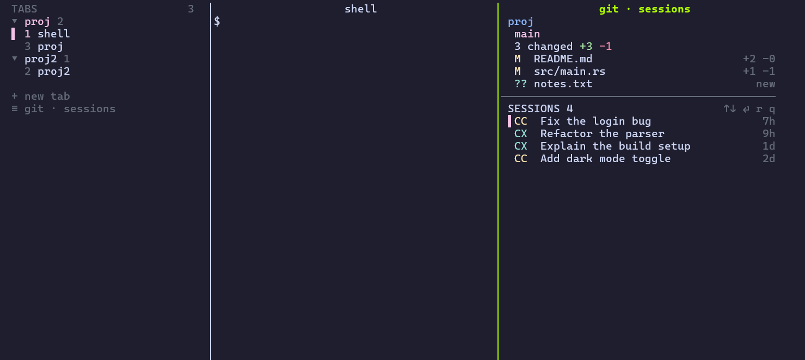

# zj-sidebar

[English](README.md)

一个 [zellij](https://zellij.dev) 插件，适合同时在很多项目里跑 Claude Code / Codex 的人。

- **左侧竖向标签栏**，按**工作目录分组**；点击分组标题折叠/展开，点击标签切换。
- **右侧 Git + 会话面板**（点击或快捷键呼出）：
  - 上半：目录名、分支（领先/落后）、改动文件及 `+新增 -删除` 行数；在文件上按 `Enter` 会在浮层里打开**左右对比的 diff**；
  - **提交**（按 `c`，或点改动行右侧的 `commit ▸`）：仿 IDEA 的提交对话框，改动文件带复选框（默认全选），可选「修改上一次提交（amend，自动填入上次的提交信息）」和「提交后 push」，提交信息可多行（`Alt+Enter` 换行）；只提交勾选的文件，新增和删除的文件也包括在内；
  - 点击分支（或按 `b`）弹出**仿 IntelliJ IDEA 的分支面板**：输入即可过滤本地/远程分支（打开时会在后台自动 fetch）；每个分支可以：checkout（远程分支会创建同名本地跟踪分支）、基于它新建分支、checkout 并 rebase、把当前分支 rebase 到它 / 把它 merge 进当前分支、push、重命名、删除；另有更新项目（pull）、push、fetch、stash/unstash，以及继续/中止正在进行的 merge、rebase；
  - 下半：该目录下的 **Claude Code 与 Codex 历史会话**（最近的在前），`↑/↓` + `Enter`（或点击）恢复：
    - 已在某个 pane 里运行（标记 `●`）→ 直接跳过去；
    - 当前 shell 空闲 → 在当前窗口输入 `claude --resume <id>` / `codex resume <id>`；
    - 否则 → 在同目录新开一个 tab。
- **Git Log 窗口**（分支行右侧的 `log ▸`、面板里按 `l`，或在 shell 里按 `Alt+Shift+g`）：所有分支的提交树，每行有 hash、引用、提交信息、作者、时间（提交之间有连接行，泳道的线是连续的）；右侧是选中提交改动的文件和完整提交信息，在文件上按 `Enter` 查看该提交的 diff。在提交上按 `Enter`（或 `m`；终端支持时也可右键）弹出 IDEA 的常用操作：复制 hash、checkout 该版本、新建分支/标签、cherry-pick、revert、reset（soft/mixed/hard/keep）、撤销提交、修改提交信息、从此处交互式 rebase、push 到此处；在文件上按 `m`：查看 diff、与本地对比、文件历史、从该版本取回。所有会改动文件、历史或远程的操作（stash、pull、push、merge、rebase、cherry-pick、revert、reset、撤销提交、删除分支……）都会先确认；git 命令失败时（push 被拒、远程连不上……）会弹窗显示完整的错误信息，直到你关闭。
- 支持 **Linux、macOS、Windows**（zellij ≥ 0.45）。



## 安装

需要 [zellij](https://zellij.dev/documentation/installation) 0.45.x 和 `git`。

**Linux / macOS**

```sh
curl -fsSL https://raw.githubusercontent.com/sunwu51/zj-sidebar/main/install.sh | bash
```

**Windows（PowerShell）**

```powershell
irm https://raw.githubusercontent.com/sunwu51/zj-sidebar/main/install.ps1 | iex
```

想同时写入 pwsh 目录跟踪钩子，先下载脚本再运行 `./install.ps1 -PatchProfile`。想从源码构建：`./install.sh --from-source` / `./install.ps1 -FromSource`（需要 Rust）。

安装脚本只放三样东西，**不会修改你的 `config.kdl`**：

| 文件 | 位置 |
|---|---|
| 插件 `zj-sidebar.wasm` | `<zellij 配置目录>/plugins/` |
| 布局 `sidebar.kdl` | `<zellij 配置目录>/layouts/` |
| 辅助程序 `zjsb-helper` | `~/.local/share/zj-sidebar/`（Windows：`%LOCALAPPDATA%\zj-sidebar\`） |

然后：

```sh
zellij --layout sidebar            # 试用（新会话用 `zellij -n sidebar`）
```

设为默认，在 `config.kdl` 加一行：

```kdl
default_layout "sidebar"
```

**首次启动**：侧边栏会向 zellij 申请权限，点一下侧边栏，按 `y`。（全新的 zellij 还会弹自己的首次向导，按 `Esc`。从 0.1.x 升级后会再申请一次，用于"复制 hash"的剪贴板权限。）

### 示例配置

[`examples/config.kdl`](examples/config.kdl) 把下面这些写在了一个文件里（默认布局、面板键 `Alt+d`、悬浮 shell 键 `Alt+j`）。它只是在 zellij 默认配置上追加，可以直接当作你的 `config.kdl`，或合并进已有的配置。

### 可选：面板快捷键

点击左侧栏底部的 `≡ git · sessions`，或绑定快捷键（安装脚本会打印带你真实路径的这一行），写在 `keybinds { shared_except "locked" { … } }` 里：

```kdl
bind "Alt d" { MessagePlugin "file:~/.config/zellij/plugins/zj-sidebar.wasm" { name "toggle_panel"; }; }
bind "Alt g" { MessagePlugin "file:~/.config/zellij/plugins/zj-sidebar.wasm" { name "focus_panel"; }; }
bind "Alt Shift g" { MessagePlugin "file:~/.config/zellij/plugins/zj-sidebar.wasm" { name "git_log"; }; }
```

`toggle_panel` 打开/关闭面板；`focus_panel` 把键盘焦点从 shell 移到面板（面板没开就先打开），再按一次回到 shell，面板保持打开；`git_log` 直接为当前 shell 所在仓库打开 Git Log 窗口。

macOS 上 `Alt` 需要终端开启 “Option 当 Alt/Meta”（kitty：`macos_option_as_alt yes`；iTerm2：Profiles → Keys → Left Option = Esc+；Terminal.app：Use Option as Meta key；Alacritty：`option_as_alt = "Both"`）。

## 使用

| | |
|---|---|
| 左侧栏 | 点分组标题折叠；点一行切换；`+ new tab` 在当前目录新开；滚轮滚动 |
| 面板 | 文件和会话是两个独立的列表，各有自己的光标、滚动和计数（文件摘要旁是 `3/18`，SESSIONS 旁是 `5/50`）：`j`/`k`/`↑`/`↓` 只在当前列表内移动，到头就停，`Tab` 切换列表，`Enter` 或再点选中行打开（文件 → diff 浮层，会话 → 恢复），`g`/`G` 第一个/最后一个，`r` 刷新，`c` 提交，`b` 分支面板，`l` Git Log 窗口，`f` fetch，`q`/`Esc` 关闭；在 shell 里按 `Alt+g` 跳进面板、再按一次跳回（见上面的快捷键） |
| 提交对话框 | 直接输入提交信息（`Alt+Enter` 或行尾 `\` 再按 `Enter` 换行，`Enter` 提交），`Tab` 切到文件/选项列表：`↑`/`↓` 移动，`Space`（或点击）勾选文件 / amend / push，`a` 全选/全不选；`Ctrl+U` 一键清空提交信息；`Esc` 关闭并保留草稿；git 拒绝时（如 hook 失败）对话框保持打开并显示错误 |
| 分支面板 | 直接输入过滤，`↑`/`↓` 移动，`Enter`/`→`（或点击）打开该分支的操作菜单（每项有字母快捷键，如 `c` = checkout），`Backspace` 删除过滤字符，`Esc` 清空过滤/关闭；在右侧面板里它占据面板主体区域 |
| Git Log 窗口 | `j`/`k` 移动，`Enter`/`m` = 该提交的操作菜单（第一项 `f` 显示改动文件），`l`/`Tab`/`→` 进入文件列表，在文件上 `Enter` = diff，`m` = 文件操作，`h`/`←` 返回；`c` 提交，`b` 分支面板，`/` 过滤（提交信息、作者、hash、引用），`a` 切换全部分支/当前分支，`y` 复制 hash/路径，`f` fetch，`r` 刷新，`q`/`Esc` 逐级返回（过滤 → 文件历史 → 分支范围）直到关闭；双击提交进入其文件列表 |
| diff 浮层 | `j`/`k` 滚动，`space`/`b` 翻页，`n`/`p` 下/上一个改动块，`]`/`[`（或 `Tab`/`Shift+Tab`）下/上一个改动文件，`h`/`l` 横向滚动，`g`/`G` 顶部/底部，`q`/`Esc` 关闭 |
| `CC`/`CX` 后的 `●` | 该会话正在当前 zellij 会话的某个 pane 中运行 |

### 配置

不配置也能用。要改的话，在 `config.kdl` 里定义别名，并让布局和快捷键都改用别名（二者必须使用**相同**的位置和设置，否则 zellij 视为不同插件）：

```kdl
plugins {
    zjsb location="file:~/.config/zellij/plugins/zj-sidebar.wasm" {
        panel_width "44"            // 右侧面板列宽
        // helper "/path/to/zjsb-helper"
        // claude_cmd "claude"      // 恢复 Claude 会话用的命令
        // codex_cmd "codex"
    }
}
```

左侧栏宽度是 `layouts/sidebar.kdl` 里的 `size=32`。

## Windows 注意

PowerShell 的 `cd` 不会改变进程工作目录，而 zellij 读的正是进程工作目录。没有下面这段（放在 `$PROFILE` 末尾）时，标签会一直按 shell *启动时*的目录分组。`install.ps1 -PatchProfile` 会帮你加：

```powershell
if ($env:ZELLIJ) {
    $global:__zellijOrigPrompt = $function:prompt
    function global:prompt {
        $loc = $ExecutionContext.SessionState.Path.CurrentFileSystemLocation
        if ($loc) { [Environment]::CurrentDirectory = $loc.ProviderPath }
        & $global:__zellijOrigPrompt
    }
}
```

Linux/macOS 上的 bash/zsh/fish 不需要。

更多可选配置（主题、默认 shell、`Ctrl+X Ctrl+E` 编辑命令行、`Ctrl+Q`/`Ctrl+S` 冲突等）见 [docs/extras.md](docs/extras.md)（英文）。

## 原理

- 一个 wasm 插件，两种模式：`tabs`（侧边栏，每个 tab 一个实例，折叠状态通过插件消息同步）和 `panel`（在当前 pane 旁打开）。
- Claude 会话读自 `~/.claude/projects/<目录>/*.jsonl`（标题取自定义/AI 标题，否则最后一条提问；时间取最后一条消息，而不是文件修改时间）。
- Codex 的会话列表在 `~/.codex/state_<n>.sqlite`，wasm 插件读不了，所以用一个小型原生程序（`helper/`）列出 `codex resume` 会显示的线程（未归档、来源为 `cli`/`vscode`）。
- “运行中”检测：helper 遍历每个 pane 的 shell 子进程。Claude 用 `~/.claude/sessions/<pid>.json`；Codex 用命令行里的 `codex resume <id>`（直接敲 `codex` 启动的识别不到）。
- “空闲”＝ pane 的前台进程是 shell。
- diff 浮层是同一个插件的第三种模式（`diff`），以浮动 pane 打开；它执行 `git diff HEAD -- <文件>`（未跟踪文件用 `--no-index` 对比 `/dev/null`；某个提交则是 `git diff <父提交> <提交>`），把删除/新增行对齐成左右两列。
- Git Log 窗口是第四种模式（`log`）：对所有分支执行 `git log --date-order`，由插件自己排布提交树的泳道（每个提交一行）。Git 操作逐条执行 git 命令，并设置 `GIT_TERMINAL_PROMPT=0`、`GIT_EDITOR=true`，不会卡在等待输入上；checkout 被本地改动挡住时，提供 IDEA 的 *smart checkout*（stash → checkout → unstash）或强制 checkout；删除未合并的分支会先确认再 `-D`。交互式 rebase 在浮动终端 pane 中打开。

## 常见问题

- **侧边栏提示权限 / 没反应**：点它，按 `y`。
- **没有 Codex 会话、没有 `●`**：helper 不在插件查找的位置或没有执行权限；手动运行 `zjsb-helper codex "$PWD"` 排查，或用别名设置 `helper`。
- **macOS 上 Alt+d 没反应**：开启 Option 当 Alt，或直接点按钮。
- **Windows 上目录分组不对**：加上面的 profile 钩子。
- **zellij 升级后插件加载失败**：插件是针对 zellij 次版本（这里是 0.45）编译的，请重装匹配的版本。

## 开发

```sh
cargo build --release                      # 插件 -> target/wasm32-wasip1/release/zj-sidebar.wasm
cargo build --release --manifest-path helper/Cargo.toml --target "$(rustc -vV | sed -n 's/^host: //p')"
bash scripts/helper-smoke-test.sh helper/target/<host>/release/zjsb-helper   # Linux/macOS
rustc --test --edition 2024 src/diffparse.rs -o /tmp/dp && /tmp/dp               # diff 解析单元测试
rustc --test --edition 2024 src/gitlog.rs -o /tmp/gl && /tmp/gl                   # log/分支解析与提交树布局测试
```

发布：推送 `vX.Y.Z` 标签，工作流会构建 wasm 插件和各平台 helper（Windows x64、Linux x64/arm64 静态 musl、macOS x64/arm64），连同 `SHA256SUMS` 一起发布。

## 许可证

MIT
