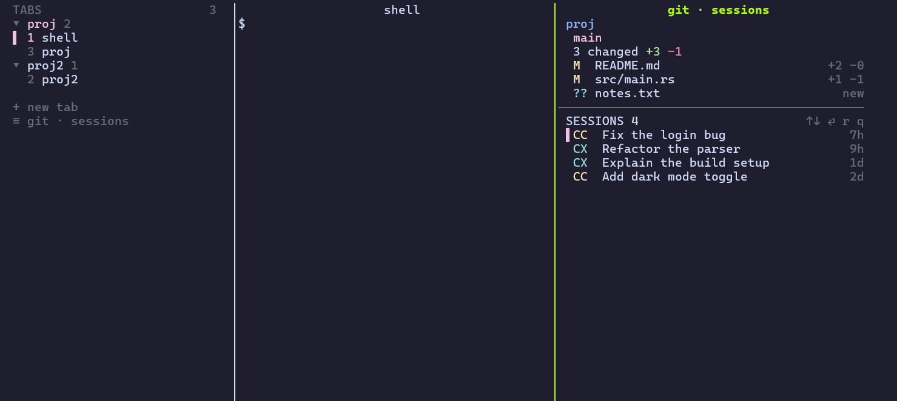

# zj-sidebar

[English](README.md)

一个 [zellij](https://zellij.dev) 插件，适合同时在很多项目里跑 Claude Code / Codex 的人。

- **左侧竖向标签栏**，按**工作目录分组**；点击分组标题折叠/展开，点击标签切换。
- **右侧 Git + 会话面板**（点击或快捷键呼出）：
  - 上半：目录名、分支（领先/落后）、改动文件及 `+新增 -删除` 行数；
  - 下半：该目录下的 **Claude Code 与 Codex 历史会话**（最近的在前），`↑/↓` + `Enter`（或点击）恢复：
    - 已在某个 pane 里运行（标记 `●`）→ 直接跳过去；
    - 当前 shell 空闲 → 在当前窗口输入 `claude --resume <id>` / `codex resume <id>`；
    - 否则 → 在同目录新开一个 tab。
- 支持 **Linux、macOS、Windows**（zellij ≥ 0.45）。



## 安装

需要 [zellij](https://zellij.dev/documentation/installation) 0.45.x 和 `git`。

**Linux / macOS**

```sh
curl -fsSL https://raw.githubusercontent.com/sunwu51/zj-sidebar/main/install.sh | bash
```

**Windows（PowerShell）**

```powershell
irm https://raw.githubusercontent.com/sunwu51/zj-sidebar/main/install.ps1 | iex
```

想同时写入 pwsh 目录跟踪钩子，先下载脚本再运行 `./install.ps1 -PatchProfile`。想从源码构建：`./install.sh --from-source` / `./install.ps1 -FromSource`（需要 Rust）。

安装脚本只放三样东西，**不会修改你的 `config.kdl`**：

| 文件 | 位置 |
|---|---|
| 插件 `zj-sidebar.wasm` | `<zellij 配置目录>/plugins/` |
| 布局 `sidebar.kdl` | `<zellij 配置目录>/layouts/` |
| 辅助程序 `zjsb-helper` | `~/.local/share/zj-sidebar/`（Windows：`%LOCALAPPDATA%\zj-sidebar\`） |

然后：

```sh
zellij --layout sidebar            # 试用（新会话用 `zellij -n sidebar`）
```

设为默认，在 `config.kdl` 加一行：

```kdl
default_layout "sidebar"
```

**首次启动**：侧边栏会向 zellij 申请权限，点一下侧边栏，按 `y`。（全新的 zellij 还会弹自己的首次向导，按 `Esc`。）

### 可选：面板快捷键

点击左侧栏底部的 `≡ git · sessions`，或绑定快捷键（安装脚本会打印带你真实路径的这一行），写在 `keybinds { shared_except "locked" { … } }` 里：

```kdl
bind "Alt b" { MessagePlugin "file:~/.config/zellij/plugins/zj-sidebar.wasm" { name "toggle_panel"; }; }
```

macOS 上 `Alt` 需要终端开启 “Option 当 Alt/Meta”（kitty：`macos_option_as_alt yes`；iTerm2：Profiles → Keys → Left Option = Esc+；Terminal.app：Use Option as Meta key；Alacritty：`option_as_alt = "Both"`）。

## 使用

| | |
|---|---|
| 左侧栏 | 点分组标题折叠；点一行切换；`+ new tab` 在当前目录新开；滚轮滚动 |
| 面板 | `j`/`k`/`↑`/`↓` 移动，`Enter` 或再点选中行打开，`r` 刷新，`q`/`Esc` 关闭 |
| `CC`/`CX` 后的 `●` | 该会话正在当前 zellij 会话的某个 pane 中运行 |

### 配置

不配置也能用。要改的话，在 `config.kdl` 里定义别名，并让布局和快捷键都改用别名（二者必须使用**相同**的位置和设置，否则 zellij 视为不同插件）：

```kdl
plugins {
    zjsb location="file:~/.config/zellij/plugins/zj-sidebar.wasm" {
        panel_width "44"            // 右侧面板列宽
        // helper "/path/to/zjsb-helper"
        // claude_cmd "claude"      // 恢复 Claude 会话用的命令
        // codex_cmd "codex"
    }
}
```

左侧栏宽度是 `layouts/sidebar.kdl` 里的 `size=32`。

## Windows 注意

PowerShell 的 `cd` 不会改变进程工作目录，而 zellij 读的正是进程工作目录。没有下面这段（放在 `$PROFILE` 末尾）时，标签会一直按 shell *启动时*的目录分组。`install.ps1 -PatchProfile` 会帮你加：

```powershell
if ($env:ZELLIJ) {
    $global:__zellijOrigPrompt = $function:prompt
    function global:prompt {
        $loc = $ExecutionContext.SessionState.Path.CurrentFileSystemLocation
        if ($loc) { [Environment]::CurrentDirectory = $loc.ProviderPath }
        & $global:__zellijOrigPrompt
    }
}
```

Linux/macOS 上的 bash/zsh/fish 不需要。

更多可选配置（主题、默认 shell、`Ctrl+X Ctrl+E` 编辑命令行、`Ctrl+Q`/`Ctrl+S` 冲突等）见 [docs/extras.md](docs/extras.md)（英文）。

## 原理

- 一个 wasm 插件，两种模式：`tabs`（侧边栏，每个 tab 一个实例，折叠状态通过插件消息同步）和 `panel`（在当前 pane 旁打开）。
- Claude 会话读自 `~/.claude/projects/<目录>/*.jsonl`（标题取自定义/AI 标题，否则最后一条提问；时间取最后一条消息，而不是文件修改时间）。
- Codex 的会话列表在 `~/.codex/state_<n>.sqlite`，wasm 插件读不了，所以用一个小型原生程序（`helper/`）列出 `codex resume` 会显示的线程（未归档、来源为 `cli`/`vscode`）。
- “运行中”检测：helper 遍历每个 pane 的 shell 子进程。Claude 用 `~/.claude/sessions/<pid>.json`；Codex 用命令行里的 `codex resume <id>`（直接敲 `codex` 启动的识别不到）。
- “空闲”＝ pane 的前台进程是 shell。

## 常见问题

- **侧边栏提示权限 / 没反应**：点它，按 `y`。
- **没有 Codex 会话、没有 `●`**：helper 不在插件查找的位置或没有执行权限；手动运行 `zjsb-helper codex "$PWD"` 排查，或用别名设置 `helper`。
- **macOS 上 Alt+b 没反应**：开启 Option 当 Alt，或直接点按钮。
- **Windows 上目录分组不对**：加上面的 profile 钩子。
- **zellij 升级后插件加载失败**：插件是针对 zellij 次版本（这里是 0.45）编译的，请重装匹配的版本。

## 开发

```sh
cargo build --release                      # 插件 -> target/wasm32-wasip1/release/zj-sidebar.wasm
cargo build --release --manifest-path helper/Cargo.toml --target "$(rustc -vV | sed -n 's/^host: //p')"
bash scripts/helper-smoke-test.sh helper/target/<host>/release/zjsb-helper   # Linux/macOS
```

发布：推送 `vX.Y.Z` 标签，工作流会构建 wasm 插件和各平台 helper（Windows x64、Linux x64/arm64 静态 musl、macOS x64/arm64），连同 `SHA256SUMS` 一起发布。

## 许可证

MIT
